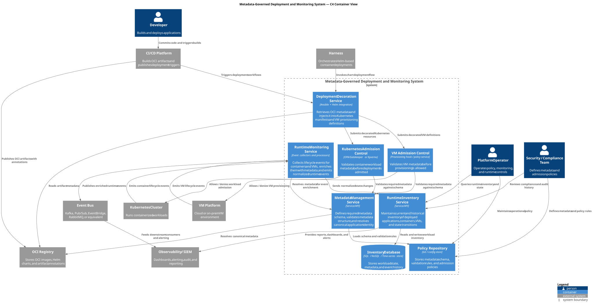

# Metadata-Governed Deployment and Monitoring — C4 Model

A C4 Level 2 (Container) model of a metadata-governed deployment and monitoring system spanning Kubernetes and virtual machines.

## Architecture

[Open the SVG](docs/diagrams/rendered/metadata-governed-deployment.svg) · [Edit the PlantUML source](docs/diagrams/metadata-governed-deployment.puml)

The model covers:

- **Deployment decoration:** retrieves OCI artifact metadata and injects it into Kubernetes manifests and VM provisioning definitions.
- **Admission control:** validates workload metadata before Kubernetes admission or VM provisioning.
- **Metadata and policy:** defines required schemas, validates metadata, and resolves canonical application identity.
- **Runtime monitoring and inventory:** enriches lifecycle events and maintains current and historical workload state.
- **Operational integration:** connects the event bus, observability/SIEM, security/compliance team, and platform operator.

This repository documents an architecture transcribed from a supplied diagram. It is not an implementation or evidence that these controls are deployed. Technology alternatives shown in the model are alternatives, not confirmed selections.

## Editing and rendering

See [development notes](docs/development.md) for source conventions and rendering instructions.
